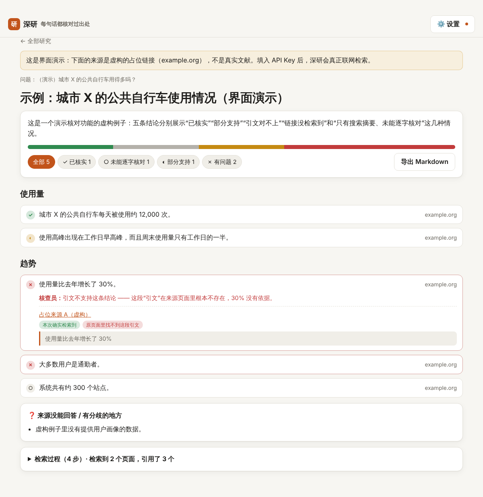

# 深研 · 每句话都核对过出处的深度研究

> AI 联网搜索、阅读来源，写成一份研究报告，然后**把报告拆成一条条结论，逐条核对出处**：引用的链接是不是本次真的检索到了？引文是不是真的出现在原页面上？最后由一个**独立的核查员**判断引文是否真的支持这句话。



## 灵感来源与改进

“让 AI 替你查资料”是 2026 年最火的 AI 产品类别之一：Manus、Genspark 这类深度研究智能体，以及 GitHub 上星标很高的 Firecrawl（约 20 万星）、browser-use（约 12 万星）。它们都会在报告里附上链接，但**附了链接不等于链接支持这句话**。常见的问题有三种：引文和原文对不上，数字被“顺手”改了，甚至链接本身是编造的。读者一般不会逐条点开核对。

深研把“核对”做成产品的核心：

| 检查 | 谁来做 | 抓住什么 |
|---|---|---|
| 链接是否真的被检索过 | **程序**：和本次的搜索结果、读取记录逐一比对（URL 先做规范化） | 编造的链接 |
| 引文是否真的在原页面上 | **程序**：对读过全文的页面做逐字查找（忽略大小写、空白、引号样式，支持省略号） | 被改过的数字、拼凑出来的“引文” |
| 引文是否支持这句话 | **独立核查员**：另一个模型只看引文、不看网页，按字面判断：支持 / 部分支持 / 不支持 / 相反 | 引文是真的，但结论说过头了 |

每条结论最后得到四种状态之一：

- **✓ 已核实**：引文在读过全文的原页面里逐字找到，并且核查员判断支持。
- **○ 未能逐字核对**：引文只来自搜索摘要，没法对照原页面。
- **◐ 部分支持**
- **✗ 有问题**

程序检查的结论优先于核查员：即使核查员说“支持”，链接是编造的或引文对不上，照样判为 ✗。

## 测试

**A. 核查员标注集**：16 组“结论 + 引文”（中文、德文、英文），每组都有已知的正确答案：5 组支持、4 组部分支持、4 组不支持、3 组相反。

**B. 程序检查的单元测试**：13 项，覆盖 URL 规范化、引文匹配、编造链接、被改动的引文和状态逻辑。

**C. 真实联网研究**：两个问题。一个是 2024 年德国可再生能源发电占比（中文），一个是间歇性断食和普通控制热量减重效果的随机对照试验证据（英文）。研究和核查用的是应用里完全相同的提示词，通过 Claude Code CLI 调用真实的 Claude（`claude-opus-5-5`）。

**D. 模拟 API 的浏览器测试**（`eval/browser-mock.cjs`）：走一遍真实应用的完整流程。第 1 次请求搜索后以 `pause_turn` 暂停，第 2 次请求带着暂停的内容继续，然后读取网页并输出报告，最后调用核查员。这次让核查员对 4 条结论**全都说“支持”**，用来确认程序检查能推翻它的判断。

| 轮次 | 结果 |
|---|---|
| [第一轮](eval/results/1-first-run/report.md) | 21/21 |
| [最终轮](eval/results/2-final/report.md) | **22/22**（加入了“○ 未能逐字核对”状态和对应的单元测试） |

结果说明：

- **核查员**：没有把不支持、相反或部分支持的结论判成“支持”（0/11）。5 组有依据的结论全部判为支持。唯一不一致的是一组“不支持”被判成了“相反”（结论说 62%，引文说 54.4%），两种结果在界面上都是 ✗。
- **没有编造链接**：两次真实研究中，16/16 和 26/26 个引用链接都在本次检索记录里。
- **模拟 API 测试（D）**：`pause_turn` 续接正确。4 条结论分别得到 ✓（引文在全文中找到）、○（只有搜索摘要）、✗（编造的链接）、✗（引文把 “Wind” 改成了 “Solar”），后两条推翻了核查员的“支持”。

### 测试环境的限制（请注意）

运行测试的云端容器的网络代理**拒绝打开普通网页**：搜索可以，读取页面不行。所以在 C 部分里，“引文是否出现在原页面”这一项无法逐字核对，已作为“跳过”单独列出，不计入总分。这也是为什么 C 部分没有一条结论是 ✓：它们最多是 ○ 或 ◐，**不会被误标成“已核实”**。

在应用里，读取网页用的是 Claude API 的服务端工具（`web_fetch`），由 Anthropic 的服务器执行，不受这个限制。这条路径已经用 D 部分的模拟 API 测试验证过，但还没有用真实 API 跑过（测试时没有可用的 API Key）。

第一轮里还有一个值得一提的现象：当页面全都打不开时，模型**没有给出任何结论**，而是把在搜索摘要里看到、却无法核实的数字放进了“未解决的问题”。

## 快速开始

```bash
npm install
npm run dev
```

先点「看界面演示」，不需要 API Key，演示里的来源是明确标注的虚构占位链接。要真正做研究，在「设置」里填入 [Anthropic API Key](https://console.anthropic.com/settings/keys)，并确保你的 Anthropic 组织在 Console 里启用了 Web search 和 Web fetch。Key 只保存在浏览器里，请求从浏览器直接发给 Anthropic。

## 代码结构

```
src/lib/prompts.ts   研究、核查的提示词和 schema（应用和 eval 共用）
src/lib/engine.ts    带服务端工具的研究循环（含 pause_turn 续接）、检索记录、程序检查、状态合成
src/components/ResearchView.tsx  报告：逐条结论、来源、核对标记、导出 Markdown
eval/run.ts          A 核查员标注集 · B 单元测试 · C 真实联网研究
eval/browser-mock.cjs  D 模拟 API 的浏览器端到端测试
```
